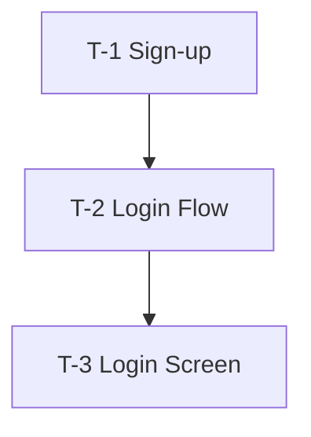

# Dependencies — [NNN-slug]

## Graph

## Waves

Tasks in the same wave do not depend on each other and can run in parallel.

| Wave | Tasks |
| --- | --- |
| 1 | T-1 |
| 2 | T-2 |
| 3 | T-3 |

## Coverage

| Requirement | Priority | Tasks |
| --- | --- | --- |
| FR-1 | Must | T-1 |
